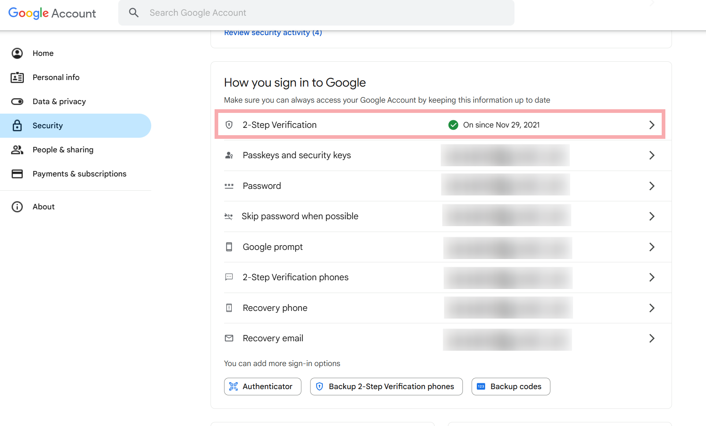
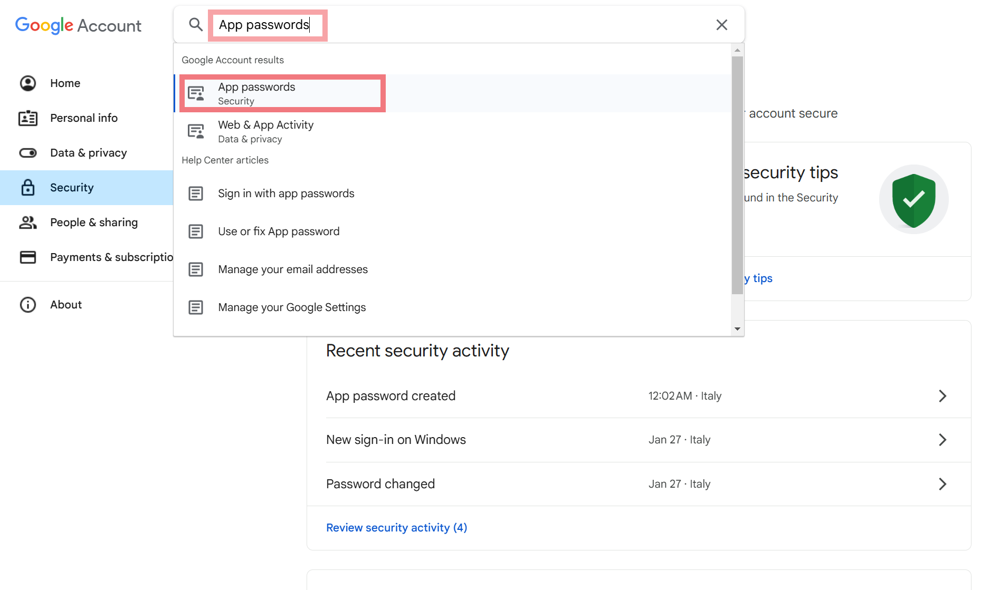
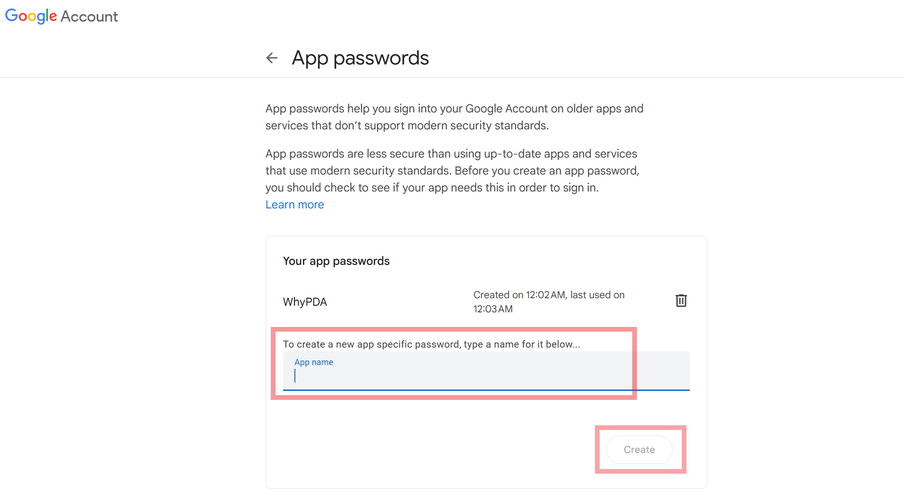

# wwwhypda

## Работа с LLM-чатами и планами

Начни с [короткой инструкции](docs/MANUAL.md). Роли, правила и планы находятся в [docs](docs/README.md). Старый TASKS заменён одним stage-планом на цикл.

## Local development

This document describes the local development environment. Install Docker with
Docker Compose and run commands from the repository root. Commands below work
in Git Bash; Docker and Git commands also work in PowerShell.

### Local configuration files

| Component | File |
| --- | --- |
| Compose database variables | `.env.development` |
| Backend | `wwwhypda-backend/env.dev` |
| Frontend | `wwwhypda-frontendV2/.env.development` |
| Docker Compose | `docker-compose.yml` |
| nginx | `nginx.dev.conf` |

The backend and frontend dev env files contain personal credentials and are
ignored by Git. The root `.env.development` contains public credentials for an
isolated local database. After cloning, create the two private dev files using
the examples below. Preserve your existing local credentials if the files
already exist. Duplicate `.example` files are not required.

### Backend env file

Create `wwwhypda-backend/env.dev`. Replace credential placeholders with your own
local development credentials. Compose supplies `DB_USER` and `DB_PASSWORD`
from the root `.env.development`.

```dotenv
MAIN_DATABASE_FILENAME='wwhypda.db'
USERS_DATABASE_FILENAME='users_data.db'
MAIL_SERVER=smtp.example.com
MAIL_PORT='465'
MAIL_USERNAME=your-email@example.com
MAIL_PASSWORD=replace-with-your-mail-app-password
SECRET_KEY=replace-with-a-long-random-secret
JWT_SECRET_KEY=replace-with-another-long-random-secret
JWT_ACCESS_COOKIE_NAME='jwt'
RECAPTCHA_SECRET_KEY=replace-with-your-recaptcha-secret
SWAGGER_URL='/swagger'
API_URL='/static/swagger.json'
ACCESS_EXPIRES_SECONDS=21600
REFRESH_EXPIRES_SECONDS=86400
TESTING=False
DEBUG=False
FLASK_DEBUG=False
DB_ENGINE=postgres
DB_USER=wwwhypda_dev
DB_PASSWORD=local-development-only
DB_HOST=db
DB_PORT=5432
MAIN_DB_NAME=wwhypda
USERS_DB_NAME=users_db
FORCE_HTTPS=False
JWT_COOKIE_SECURE=False
JWT_REFRESH_COOKIE_PATH=/api/users/refresh
JWT_COOKIE_SAMESITE=Lax
JWT_COOKIE_CSRF_PROTECT=True
JWT_REFRESH_COOKIE_NAME=refresh_token_cookie
JWT_ACCESS_COOKIE_PATH=/
JWT_ACCESS_CSRF_COOKIE_NAME=csrf_token
JWT_REFRESH_CSRF_COOKIE_NAME=csrf_refresh_token
SESSION_COOKIE_SAMESITE=Lax
MAIL_USE_TLS=False
MAIL_USE_SSL=True
MAIL_DELIVERY_MODE=smtp
MAIL_SUPPRESS_SEND=False
CONFIRMATION_CODE_TTL_SECONDS=120
PASSWORD_RESET_CODE_TTL_SECONDS=120
AUTH_CODE_CLEANUP_INTERVAL_SECONDS=60
DATA_RETENTION_CLEANUP_INTERVAL_SECONDS=3600
RECAPTCHA_ENABLED=True
RECAPTCHA_VERIFY_URL=https://www.google.com/recaptcha/api/siteverify
RECAPTCHA_MIN_SCORE=0.5
RECAPTCHA_TIMEOUT_SECONDS=5
RECAPTCHA_RETRIES=3
RECAPTCHA_RETRY_DELAY_SECONDS=1
RATELIMIT_ENABLED=True
RATELIMIT_DEFAULT=40000 per day;6800 per hour
RATELIMIT_STORAGE_URI=memory://
FRAME_OPTIONS=SAMEORIGIN
REFERRER_POLICY=no-referrer-when-downgrade
LOG_LEVEL=INFO
APP_HOST=127.0.0.1
APP_PORT=5000
PROXY_X_FOR=1
PROXY_X_PROTO=1
PROXY_X_HOST=1
CORS_ALLOW_HEADERS=["Content-Type", "Authorization", "X-CSRF-TOKEN", "X-Recaptcha-Token"]
CORS_SUPPORTS_CREDENTIALS=True
ENABLE_TEST_ENDPOINTS=False
APP_ENV=development
SESSION_COOKIE_SECURE=False
HSTS_ENABLED=False
HSTS_MAX_AGE=31536000
HSTS_INCLUDE_SUBDOMAINS=False
CSP_POLICY={"default-src":["'self'"],"script-src":["'self'","https://www.google.com/recaptcha/","https://www.gstatic.com/recaptcha/"],"frame-src":["'self'","https://www.google.com/recaptcha/","https://recaptcha.google.com/recaptcha/"],"connect-src":["'self'","https://www.google.com/recaptcha/","http://localhost:8080","http://localhost:5173","http://localhost:3000"],"style-src":["'self'","'unsafe-inline'"],"img-src":["'self'","data:"],"font-src":["'self'"],"object-src":["'none'"],"base-uri":["'self'"],"form-action":["'self'"]}
CORS_ORIGINS=["http://localhost:8080", "http://localhost:5173", "http://localhost:3000"]
EXPOSE_ERROR_DETAILS=True
AUTH_LOGIN_RATE_LIMIT=60 per minute;200 per hour
AUTH_REGISTRATION_RATE_LIMIT=60 per minute;200 per hour
AUTH_CONFIRMATION_RATE_LIMIT=60 per minute;200 per hour
AUTH_PASSWORD_RESET_RATE_LIMIT=60 per minute;200 per hour
AUTH_RESEND_RATE_LIMIT=60 per minute;200 per hour
MAIL_DEFAULT_SENDER=your-email@example.com
SWAGGER_ENABLED=True
SQLALCHEMY_TRACK_MODIFICATIONS=False
JWT_TOKEN_LOCATION=["cookies"]
```

`CSP_POLICY` is a JSON object. `CORS_ORIGINS`, `CORS_ALLOW_HEADERS` and
`JWT_TOKEN_LOCATION` are JSON arrays. Boolean settings use `True` / `False`.
Rate limits use syntax such as `2 per minute;20 per hour`.

### Frontend env file

Create `wwwhypda-frontendV2/.env.development`:

```dotenv
VITE_API_BASE_URL=/api
VITE_RECAPTCHA_SITE_KEY=replace-with-your-development-recaptcha-site-key
VITE_CYPRESS_TEST=false
VITE_NAVIGATE_URL=http://localhost:8080
```

Use a reCAPTCHA v3 site key and secret key from the same development registration.
Allow `localhost` in that key's domain settings. The site key belongs in the
frontend env file; the secret key belongs only in backend `env.dev`.

Normal local use keeps `RECAPTCHA_ENABLED=True`, `TESTING=False`,
`ENABLE_TEST_ENDPOINTS=False` and `VITE_CYPRESS_TEST=false`. Public
`/api/rocks/rock_type` and `/api/rocks/parameters` requests do not require login,
and in the local cycle 003 code no longer require a CAPTCHA token; ordinary request limits remain.

Настройки SMTP независимы от CAPTCHA. Настройте собственный почтовый аккаунт для разработки. В режиме `MAIL_DELIVERY_MODE=log` отправка пропускается и в журнал записывается только факт пропуска; код, адрес получателя и тело письма не выводятся. Этот режим не доставляет код пользователю.

### Create your own development credentials

For reCAPTCHA, register a reCAPTCHA v3 key in the
[reCAPTCHA console](https://www.google.com/recaptcha/admin) and allow `localhost`.
Put its site key in frontend `.env.development` and its paired secret key in
backend `env.dev`. Use your own credentials rather than somebody else's keys.

For Gmail SMTP, enable 2-Step Verification on your own account and create an
app password. Availability depends on the account; see
[Google's app password instructions](https://support.google.com/accounts/answer/185833).
Use your email address for `MAIL_USERNAME` and `MAIL_DEFAULT_SENDER`, and the app
password for `MAIL_PASSWORD`. For SMTP over SSL use `MAIL_SERVER=smtp.gmail.com`,
`MAIL_PORT=465`, `MAIL_USE_SSL=True`, `MAIL_USE_TLS=False` and
`MAIL_DELIVERY_MODE=smtp`. These are settings for your own local mail account.

1. Enable 2-Step Verification:

   

2. Find App passwords in the account settings:

   

3. Create an app password for the local application:

   

### Start, stop and rebuild

Before starting a backend built from cycle 002, apply the adding retention migration
and verify it with `--check` as described below. Do not restart the new backend
against an unmigrated existing database. The retention worker is opt-in and is
not started by this ordinary command.

Start the local application:

```sh
docker compose --env-file .env.development up --build -d
```

Website: http://localhost:8080. DbGate: http://localhost:8081.

Stop and then rebuild/restart:

```sh
docker compose --env-file .env.development stop
docker compose --env-file .env.development up --build -d
```

Use the rebuild command after changing source code or env files. This setup
builds the frontend and serves it through local nginx; it does not run a
frontend HMR server. Reload the browser after rebuilding.

Check status and recent logs:

```sh
docker compose --env-file .env.development ps
docker compose --env-file .env.development logs --since 5m --tail 50 backend nginx
```

`stop` preserves data. `down` removes containers but preserves named volumes.
`down -v` deletes the local PostgreSQL volume.

### Local databases

On the first start with an empty local PostgreSQL volume, `init-db.dev.sh`
restores `wwhypda` and `users_db` from the SQL files in `db_dumps`.
Existing database contents are preserved. The script aligns five historical
table names with the current models and initializes missing ID sequences for
users, confirmation codes and submissions. Other historical tables are retained.

In DbGate use host `db`, port `5432` and the credentials in the root
`.env.development`. The databases are `wwhypda` and `users_db`.

To rerun local initialization without replacing existing data:

```sh
docker compose --env-file .env.development exec -T db sh /docker-entrypoint-initdb.d/init-db.dev.sh
```

For a local API check without login or CAPTCHA:

```sh
curl -i --max-time 15 http://localhost:8080/api/rocks/anonce
```

Check backend logs as well: this handler can return `[]` after a database error.
For CAPTCHA failures, inspect the rejection reason in backend logs. An HTTP
`200` from Google does not by itself confirm a valid token; verify that the
development key permits `localhost`.

### Generated files and Git

`wwwhypda-frontendV2/dist` is build output and is ignored by Git. Static source
assets remain in `wwwhypda-frontendV2/public`. Dependencies and caches are also
ignored.

In Git Bash, list untracked files, including private ignored configs, while
excluding builds, dependencies and caches:

```bash
git ls-files --others | grep -Ev '(^|/)(dist|build|node_modules|__pycache__|workEnv|venv|\.venv|\.vite|\.pytest_cache|\.mypy_cache|\.ruff_cache|coverage)(/|$)|\.(pyc|pyo|tsbuildinfo)$|-(shm|wal)$'
```

Check whether a file is tracked and why it is ignored:

```sh
git ls-files --error-unmatch wwwhypda-backend/env.dev
git check-ignore -v wwwhypda-backend/env.dev
```

An untracked file can still be required by the application. Check code and
Compose references before deleting it.

Commit code and documentation normally:

```sh
git add -A
git diff --cached
git commit -m "Describe your changes"
git push origin main
```

`git add -A` respects `.gitignore`. Ignore rules do not protect files that Git
already tracks. Review the staged diff and keep real credentials out of Git.

## Удаление аккаунта и срок кодов

В новой версии кнопка `Delete account` доступна в обычном и административном аккаунтах. Подтверждение требует текущей JWT-сессии, пароля и CSRF; в локальном цикле 003 дополнительная CAPTCHA для этой авторизованной операции снята. Сервер удаляет собственный аккаунт, его заявки всех статусов и коды одной транзакцией в users_db; старые access/refresh JWT больше не дают доступа. Независимые исторические научные таблицы не удаляются по совпадению имени автора. После успеха браузер очищает состояние пользователя и черновики, сохраняя тему; другие вкладки того же сайта получают уведомление. Сервер не может сам очистить браузерное хранилище другого устройства. Письма и резервные копии имеют отдельный жизненный цикл.

Несекретные настройки в существующих backend env-файлах:

```dotenv
CONFIRMATION_CODE_TTL_SECONDS=120
PASSWORD_RESET_CODE_TTL_SECONDS=120
AUTH_CODE_CLEANUP_INTERVAL_SECONDS=60
DATA_RETENTION_CLEANUP_INTERVAL_SECONDS=3600
```

Код действителен 2 минуты от создания; на границе 120 секунд он уже отклоняется. Использованный код удаляется сразу. Отдельный dev-сервис `auth-code-cleanup` запускает проход немедленно, затем каждую минуту; при штатной работе истёкшая запись удаляется примерно в пределах 3 минут от создания. При сбое БД проход откатывается и повторяется. Истёкший код остаётся недействительным, даже пока очистка недоступна. Удаление кода не удаляет незавершённый аккаунт. Таймер не запускается в Gunicorn workers.

Локальная одноразовая проверка очистки (удаляет только истёкшие коды dev-БД):

```sh
docker compose --env-file .env.development run --rm --no-deps auth-code-cleanup python -m auth.code_cleanup --once
```

Тесты с изолированными SQLite БД без env-файлов и SMTP:

```sh
docker compose --env-file .env.development build backend
docker run --rm wwwhypda-dev-backend python -m unittest discover -s tests -v
```

Проверки настоящих блокировок и отдельного worker-процесса требуют отдельной тестовой PostgreSQL БД, переданной через `TEST_AUTH_DATABASE_URI`; их нельзя направлять в рабочую БД. Проверки очистки браузерного состояния и поздних ответов Axios:

```sh
docker compose --env-file .env.development run --rm --build --no-deps frontend node --experimental-vm-modules --test scripts/test-account-session.mjs
```

Раздел Privacy Policy сначала был подготовлен как описание будущих изменений, затем согласован с реализованной очисткой и удалением. Перед выпуском остаются проверки резервных копий и браузерных сценариев. Старые JWT без привязки к версии аккаунта после обновления отклоняются: пользователям нужно заново войти. Неоднозначные старые метки редактора при совпадающих именах сохраняются для отдельного рассмотрения, чтобы не удалить чужие сведения.


## Масштабирование интерфейса и Community-таблицы

Размеры форм, кнопок, подписей, строк таблиц и промежутков переведены в rem/em и общую шкалу CSS-переменных для штатного browser zoom. Оболочка прокручивается целиком: шапка, содержимое и футер; таблицы сохраняют прокрутку строк и столбцов. Узкая раскладка допускает перенос меню и размещение дерева над содержимым; прежнее предупреждение 600×559 больше не закрывает страницу.

Таблицы используют только ag-grid-community и ag-grid-react одной версии 35.2.0. Платное выделение диапазонов/fill handle отключено; редактирование отдельных ячеек и существующий XLSX-экспорт через xlsx сохранены. Закомментированные Enterprise-импорты сохранены по правилам проекта и не подключаются. Локальная пользовательская приёмка интерфейса завершена в цикле 005; источник подтверждения и ограничения записаны в архиве, сборка сама по себе её не заменяет.


## Автоматическое удаление регистраций и приватных заявок (локальный цикл 002)

Локально реализованы `User.registered_at` и `registration_completed`, добавляющая
PostgreSQL-миграция `auth.migrate_retention` и отдельный процесс
`maintenance.retention_cleanup`. Реальное включение на VPS не выполнено.
Подготовленные публичные тексты и договор `2026-10-14.2` выпускаются вместе с
миграцией и включённым, проверенным worker после отдельного разрешения. Старые
тексты действующего сайта до выпуска продолжают описывать его прежний режим.
Локальный цикл принят пользователем и завершён; результаты и ограничения сохранены
в [архиве плана 002](docs/archive/002-automatic-data-retention.md).

Срок незавершённой регистрации — один календарный месяц от первоначального
серверного `registered_at`; повторная регистрация и resend срок не продлевают.
Условие удаления: `active=False`, `registration_completed=False`, известная дата,
срок достигнут, аккаунт не superuser. Любая успешная активация сохраняет
`registration_completed=True`, последующее отключение его не сбрасывает.
`terms_accepted_at` остаётся отдельным фактом и не используется как дата регистрации.
Удаление аккаунта одной транзакцией убирает аккаунт/acceptance, его заявки всех
статусов, коды обоих типов и однозначные чужие метки `editing_by`. При совпадающих
именах метки сохраняются для рассмотрения оператором.

Заявки `InputData` удаляются через шесть календарных месяцев от исходного
`created_at` независимо от статуса и редактирования. Удаление заявки сохраняет
аккаунт и его коды. Даты трактуются в UTC, время суток сохраняется; отсутствующий
день ограничивается последним днём целевого месяца. Шесть месяцев прибавляются
сразу, без последовательного округления. Worker делает проход сразу, затем
ожидает 3600 секунд: удаление происходит на первом успешном проходе после срока,
обычно в пределах следующего часа плюс длительность прохода. Сбой/остановка могут
задержать удаление; оператор проверяет последние успешные проходы и просроченное.
Интервал положительный и не больше 3600, в dev/prod Compose явно одинаковый.

Legacy: миграция не выдумывает возраст и не заполняет прошлым аккаунтам сегодняшнюю
дату. Старым активным допускается `registration_completed=True`; выключенные с
неизвестной историей остаются NULL. Такие строки, даты из будущего, заявки без даты
и superuser-аккаунты требуют операторского разбора перед включением. Dry-run
показывает только агрегаты `unknown_accounts`, `unknown_submissions` и
`protected_superusers`, без адресов, имён, ids и тел заявок. Содержимое рабочей
dev/prod БД в этом цикле не подсчитывалось и не удалялось. Для неизвестных записей
нельзя считать отсутствие автоматического удаления выполнением срока хранения.

Автоматика не касается публичного rocks/source-каталога, чужих браузеров,
почтовых ящиков, журналов и backup провайдера. Ручная обработка более ранних
privacy-запросов, самоудаление и удаление отдельной заявки сохраняются. При
восстановлении backup до возвращения данных в использование повторно применяются
как законные запросы удаления, так и достигнутые плановые сроки.

### Порядок будущего включения (не выполнен этим циклом)

Команды ниже — инструкция для отдельного согласованного включения, не разрешение
применять миграции или удаления к рабочим данным. Сначала проверить сборку на
изолированном стенде. Для dev выбранный backend-env Docker читает сам; секреты
не выводить и не использовать `compose config`.

```sh
docker compose --env-file .env.development build backend
# db должен быть доступен; старый backend ещё не заменять.
docker compose --env-file .env.development run --rm --no-deps backend python -m auth.migrate_retention
docker compose --env-file .env.development run --rm --no-deps backend python -m auth.migrate_retention --check
# Если ещё не применялась миграция acceptance — отдельно применить/проверить её.
docker compose --env-file .env.development up -d --no-deps --no-build backend auth-code-cleanup
# Явно указанный сервис можно запускать одноразово без включения его профиля.
docker compose --env-file .env.development run --rm --no-deps retention-cleanup python -m maintenance.retention_cleanup --once
# Разобрать legacy/предохранители, оценить счётчики; только затем разрешить удаление.
docker compose --env-file .env.development --profile retention up -d --no-deps --no-build retention-cleanup
docker compose --env-file .env.development logs --since 2h --tail 30 retention-cleanup
# После проверки worker обновить согласованный frontend bundle и проверить страницы.
docker compose --env-file .env.development up --build --no-deps frontend
```

Порядок: добавляющая миграция → `--check` → новый backend → одноразовый dry-run
worker → разбор legacy и явное включение `--worker --execute` → контроль успешных
проходов → согласованные тексты/frontend. Обновление frontend и backend версии
договора должно быть согласованным; прежние принятия не перезаписываются и
автоматического повторного принятия для старых аккаунтов нет.

`--once` без `--execute` только читает. Одноразовое удаление требует обоих флагов;
не использовать его для проверки рабочей dev-БД. `--worker` также требует
`--execute`, корректно обрабатывает SIGTERM/SIGINT, закрывает сессии и после ошибки
ждёт интервал перед повтором. Не запускается в HTTP/Gunicorn и не отправляет почту.
При неприменённой/несовместимой схеме старт завершается безопасной ошибкой до удаления.

И dev, и локальный приватный `docker-compose.prod.yml` содержат сервис
`retention-cleanup` с профилем `retention`. Для prod заранее собрать
`wwwhypda-backend:local`, доставить конфигурацию отдельно, выполнить миграцию и
проверку выбранной users_db, dry-run и явное включение профиля по тому же порядку.
Приватные `docker-compose.prod.yml`, `nginx.conf`, `wwwhypda-backend/env.prod`,
`wwwhypda-frontendV2/.env.production` и `Dockerfile.prod` игнорируются Git:
`git pull` их не доставляет. Здесь prod-файл подготовлен только локально.

### Изолированные проверки

```sh
docker compose --env-file .env.development build backend
docker run --rm --pull=never --network none -e TEST_AUTH_DATABASE_URI=sqlite:// --entrypoint python wwwhypda-dev-backend -m unittest tests.test_retention_cleanup tests.test_auth_lifecycle tests.test_terms_acceptance tests.test_submission_authors -v
docker compose -p wwwhypda-retention-tests -f deploy/testing/retention.compose.yml up --abort-on-container-exit --exit-code-from tests
docker compose -p wwwhypda-retention-tests -f deploy/testing/retention.compose.yml down
```

Тестовый project использует PostgreSQL 15, tmpfs и открытые синтетические
реквизиты: нет env_file, опубликованных портов, рабочих volumes и данных. SQLite
не доказывает row locks; PostgreSQL suites обязательны. `create_all/drop_all` в
этих tests применяются только к тестовому URI. Транзакции в users_db используют
общий PostgreSQL advisory lock перед User/InputData locks (SQLite no-op).
Это консервативно сериализует auth/заявочные операции и исключает deadlock при
очистке `editing_by` между владельцами; нагрузочные свойства требуют отдельной
оценки при росте сервиса. Батчи ограничены 100 кандидатами, коммит между батчами;
при ошибке откатывается текущий батч, ранее завершённые сохраняются. Retry безопасен.


### Login 500 после обновления backend

Если новый dev backend уже запущен, а `POST /api/users/login` возвращает 500 с
безопасным журналом ProgrammingError, первым делом выполнить read-only
`auth.migrate_retention --check`. Отсутствующие поля registered_at /
registration_completed требуют добавляющей миграции **выбранной локальной**
users_db и повторного --check командами выше, по разрешению оператора. Это не
запуск retention-cleanup и не удаление аккаунтов/заявок. После успешной проверки
перезагрузить страницу и повторить вход. Сообщение `ReCAPTCHA not available yet`
до готовности provider не сопровождается POST и требует дождаться загрузки;
сохранение этой ошибки после reload требует отдельной диагностики browser/network,
а не отключения CAPTCHA.


## reCAPTCHA — завершённый локальный цикл 003

В коде оставлены только явные search/login/register/confirmation/resend/password-reset
действия. Скрипт загружается лениво после попытки действия на /search, /login, /register,
/forgot-password; форма остаётся смонтированной, token не кэшируется. Timeout
ожидания/ошибка показываются существующим сообщением, сетевой запрос не отправляется
с молчаливым обходом CAPTCHA. Начальные справочники, /users/check, post-login/refresh
checks и авторизованные submit/delete не обращаются к Google. JWT/current account,
CSRF, role/ownership, password и rate limits сохранены. Переход между auth-группой
и прочими страницами перезагружает документ; localStorage/Redux drafts не очищаются
этим механизмом. Неактивный tokenRefresh не включён попутно.

Server SiteVerify требует success=True, конечный числовой score и достаточный порог,
фиксированный endpoint expected action, точный hostname. Google проверяет срок и
одноразовость токена; success=True с непустым error/error-codes (включая quota
fallback legacy SiteVerify) также отклоняется; cookie expiry эту проверку не заменяет. Журналы не выводят
ответы Google, токены, адреса и произвольные hostname/action. Test bypass действует
только при TESTING=True; production запрещает отключённую или не настроенную CAPTCHA.

Несекретная новая настройка backend: `RECAPTCHA_ALLOWED_HOSTNAMES` — JSON-массив
точных hostname без scheme/path/port/wildcard. Dev default — ["localhost","127.0.0.1"].
Production требует явный непустой список действительных доменов владельца и
не допускает localhost/IP/зарезервированные тестовые домены. Владелец подтвердил
production-домены wwhypdatestdeployversion.it и www.wwhypdatestdeployversion.it;
prod-env и VPS в этом цикле не читаются/не меняются. Секретный ключ
остаётся в выбранном env и не выводится. RECAPTCHA_VERIFY_URL допускает официальный
HTTPS siteverify Google или recaptcha.net; новые платные assessments не вводились.

Тип v3/настройки записи wwhypdatestdeployversion, домены и адресное уведомление
Google о CDPA с 02.04.2026 подтверждены владельцем. [Итоговая пофункциональная
оценка](deploy/privacy/recaptcha-assessment.md) поддерживает ограниченный технический
security-only режим без дополнительного consent-banner; [DPIA](deploy/privacy/recaptcha-dpia.md)
учитывает persistent cookie, передачи и ложные отказы. Это оценка конкретного scope,
не blanket-exemption для новых целей или утверждение о GDPR всего сайта.
[Browser-проверка](deploy/privacy/recaptcha-browser-check.md) и
[архив цикла](docs/archive/003-recaptcha-consent-assessment.md) фиксируют выполненные
проверки, приёмку владельца Firefox и пределы наблюдений. Production-публикация требует отдельного разрешения
и проверки соответствующей среды; в локальном цикле VPS не затрагивается.

Синтетические тесты без сети/SMTP/рабочих данных:

```sh
docker compose --env-file .env.development build backend
docker run --rm --pull=never --network none -e TEST_AUTH_DATABASE_URI=sqlite:// --entrypoint python wwwhypda-dev-backend -m unittest tests.test_recaptcha_policy tests.test_auth_lifecycle tests.test_terms_acceptance tests.test_submission_authors -v
docker compose --env-file .env.development run --rm --no-deps frontend node --test scripts/test-recaptcha-scope.mjs
docker compose --env-file .env.development run --rm --no-deps frontend node --experimental-vm-modules --test scripts/test-account-session.mjs
```

После успешных сборки/тестов dev bundle и backend обновлять согласованно:

```sh
docker compose --env-file .env.development up -d --no-deps --no-build backend
docker compose --env-file .env.development up --build --no-deps frontend
```

Эти команды не запускают retention-профиль, не применяют миграции и не требуют
создавать/удалять аккаунты. Для browser smoke не отправлять реальные регистрации,
reset emails или научные данные. Обновление localhost не является deployment на VPS.


## Защита auth от раскрытия аккаунтов (локальный цикл 004)

Запрос/resend сброса, регистрация и resend активации возвращают нейтральные
сообщения; после reset-запроса форма показывает одинаковый шаг ввода кода и
30-секундный отсчёт. Ответ не подтверждает наличие аккаунта или доставку письма.
Восстановление разрешено только active, activation — явно незавершённой регистрации.
Failed login выполняет одну реальную/dummy hash-проверку; пароли/acceptance дубликата
регистрации не меняются. CAPTCHA и rate limits остаются обязательными.

Для register/resend/reset задан общий elapsed floor 4s, failed login — 0.4s после
общей валидации/CAPTCHA. SMTP sender ожидается до 3s и завершается до ответа,
не более двух child на Linux container. Требуется штатный Linux Docker runtime
(prctl, signals, flock и доступный /tmp); новых env-настроек и миграций нет.
Ожидание освобождает DB transaction/locks, но занимает HTTP worker. Перед отдельным
разрешённым production rollout нужны SMTP latency/capacity checks; полный сетевой
audit локальными synthetic тестами не заменяется.

Дополнительные проверки без сети и рабочей БД после сборки образов:

```sh
docker run --rm --pull=never --network none -e TEST_AUTH_DATABASE_URI=sqlite:// --entrypoint python wwwhypda-dev-backend -m unittest tests.test_password_reset_privacy tests.test_auth_enumeration -v
docker run --rm --pull=never --network none --entrypoint node wwwhypda-dev-frontend --experimental-vm-modules --test scripts/test-auth-privacy.mjs
```

Результаты, измерения и ограничения: [архив цикла 004](docs/archive/004-password-reset-enumeration.md).


## Search, тема и непрерывная навигация (локальный цикл 005)

MainWindow сохраняется при внутренних переходах; смена CAPTCHA scope не делает
reload и не скрывает оболочку. Google v3 SDK исполняется в отдельной same-origin
recaptcha-frame.html, создаваемой только при разрешённом действии; уход отменяет
ожидающую проверку и удаляет frame. SiteVerify/action/hostname/score, API, JWT/CSRF
и rate limits не менялись. Iframe lifetime не является полной same-origin границей
доверия; Google cookies удалять не обещает. Реальная production приёмка отдельная.

public/theme-bootstrap.js до React восстанавливает прежний localStorage.isDarkTheme
в html[data-theme], сохраняя dark default. Палитра общая в menu.module.scss;
переключение синхронизирует атрибут, Redux и .dark, без light cleanup на навигации.
Search использует фиксированные 44rem без viewport/outerHeight по уточнению владельца
(рост при приближении допускает внешний scroll),
увеличенные боковые отступы и кнопку внизу формы. Результаты и ограничения локальной
приёмки: [архив 005](docs/archive/005-search-height-and-navigation.md).

Дополнительные unit-проверки (после штатной Docker-сборки frontend):

```sh
docker run --rm --pull=never --network none --entrypoint node wwwhypda-dev-frontend --experimental-vm-modules --test scripts/test-navigation-lifecycle.mjs scripts/test-recaptcha-scope.mjs scripts/test-account-session.mjs scripts/test-auth-privacy.mjs
```

Это не браузерный тест. После исходных правок обновлять раздаваемый bundle штатным
`docker compose --env-file .env.development up --build --no-deps frontend`, затем
Ctrl+F5 на localhost:8080. Сборка включает два HTML entry: index и recaptcha-frame;
новых env-настроек/зависимостей/миграций нет, VPS не затрагивается.


## Публичный поиск и управление панелями (локальный цикл 006)

Search использует GET /api/rocks/search?rock_type_id=<ID>&parameter_id=<ID|all>:
обычная порода/параметр, порода/все параметры, All rock types/параметр и оба all.
All rock types — подпись исходного корня каталога, ID не заменяется константой;
обычные папки сохраняют точное равенство породы без потомков. Ответ — плоские строки
измерений с row_id, образцом/породой/параметром/единицами, без агрегации. All parameters выбран по умолчанию и
включает образцы без измерений (null); повторы/нули сохраняются в таблице и XLSX.
CAPTCHA header/action search и глобальный rate limit прежние; старый int/int endpoint
совместим. Частные заявки в поиск не включаются. Схема/миграции/новые env не нужны.

View переключает Tree/Search form/Results независимо, Show all восстанавливает панели.
Размер страницы таблицы автоматически подбирается по её высоте (paginationAutoPageSize),
чтобы строки помещались без внутреннего вертикального scroll; горизонтальный scroll сохранён.
Состояние живёт в текущем Search, панели/AG Grid не размонтируются; единственная панель
занимает весь workspace. Общая высота wide 38rem вместе с View (высота панелей уменьшена на toolbar и отступ), есть reduced-motion. Корень/группы дерева
выделены, отступ растёт с глубиной. Корневая полоса прокрутки CSS запрошена постоянно,
но OS overlay/auto-hide может иметь приоритет. Logout расположен сверху справа в нейтральном контурном стиле,
Delete account — внизу по центру, без изменения auth/confirmation. Функциональная приёмка владельцем получена; формальная матрица/набор скриншотов
исключены владельцем из этого цикла, ограничения записаны в [архиве 006](docs/archive/006-search-all-parameters.md).

Изолированная серверная проверка без рабочей DB/env/network после build backend:

```sh
docker run --rm --pull=never --network none --entrypoint python wwwhypda-dev-backend -m unittest tests.test_catalog_search tests.test_recaptcha_policy.VerifierTests -q
```

Frontend suites запускаются прежней командой четырёх scripts из раздела 005;
они дополнены проверками all/stale/panels/tree/XLSX/accounts, не заменяют browser QA.


## SMTP OVH (локальная подготовка, цикл 007)

Flask-Mail сохранён; SSL/TLS проверяет сертификат и hostname, SMTP fallback отсутствует.
Существующие переменные MAIL_* и оставшиеся действия владельца:
[инструкция OVH SMTP](deploy/mail/ovh-smtp.md).
IMAP/очистка, env, публичные контакты и VPS в этом цикле не изменены.
Проверки и ограничения: [архив 007](docs/archive/007-ovh-smtp.md).


## IMAP OVH — локальная подготовка цикла 008

Независимая задача по умолчанию readonly DRY_RUN; не включена в обычный запуск.
[Настройка, ограничения и реальная приёмка Zimbra](deploy/mail/ovh-cleanup.md).
Автоудаление поддержки запрещено; реальный ящик ещё не проверен. Локальная
Gmail-инструкция выше сохраняется. Никакой timer/deployment автоматически не выполняется.


## Документы/PDF и принятие редакции — локальный цикл 008

[Сборка трёх PDF и согласованный release](deploy/privacy/legal-pdf-release.md).
Текущая локальная редакция 2026-10-18.2, текущие HTML и PDF имеют один источник; прежние PDF сохранены.
При обновлении редакции login/active/refresh/direct APIs требуют явного принятия;
история сохраняется отдельно, старые User факты не перезаписываются.
Перед будущим rollout обязательна новая добавочная миграция users_db
auth.migrate_agreement_history и --check, пока она проверяется только на
изолированной PostgreSQL. На VPS новый код/документы не публиковались.
Обычная локальная настройка Gmail выше сохраняется.


Решение 18.10.2026: обычная поддержка удаляется вручную не позднее шести календарных
месяцев после записанного закрытия, раньше при отсутствии необходимости/применимом
запросе. Служебные копии сохраняют свой месяц; автоматическое support-delete запрещено.
Процедура приватной связи цепочки с dueAt и напоминаниями — deploy/mail/ovh-cleanup.md.
Новая редакция активируется после согласованного backend/frontend/PDF rollout;
commit/git pull сами по себе не обновляют контейнеры и не требуют сброса acceptance.


Локальный цикл 009: [изолированная приёмка](deploy/testing/stage009-preview.md),
[manual maintenance](deploy/maintenance/README.md),
[no-send reminders и будущий timer](deploy/mail/reminders.md).
Dev frontend готовит отдельный maintenance assets volume из canonical sources;
flag выключен по умолчанию. Рабочую users_db перед новым backend обновлять только
добавочной auth.migrate_registration_limits с последующим --check, после обычной
проверки migration/backup оператором. Этот цикл рабочую БД не изменяет.
Настройка Gmail для обычной local development выше сохраняется; production
reminder требует отдельно проверенный OVH transport и явное включение.


## Stage010: сессии и локальный запуск

Backend использует persistent sid и reset budget; перед первым запуском новой
версии требуется additive migration `python -B -m auth.migrate_security_state`
и затем `--check` через backend Docker Compose. В текущей локальной тестовой БД
они уже выполнены. Обычный UI dev остаётся http://localhost:8080; после правки
frontend пересобрать `docker compose build frontend`, затем `docker compose up -d frontend`
и дождаться `docker compose wait frontend` перед Ctrl+F5.
Старые JWT требуют нового входа. Инструкция будущего согласованного rollout:
[stage010-rollout](deploy/security/stage010-rollout.md). Изолированные автотесты:
[security010](deploy/testing/security010/README.md). Secrets/env здесь не приводятся;
универсальная локальная Gmail-инструкция выше сохраняется.

## Experimental logo laboratory

The local public experiment is available at `/logo-lab` through the Logo lab main-menu link when enabled.
It uses a frozen snapshot of complete public Search leaf names in
`wwwhypda-frontendV2/src/components/logoLab/rockNames.snapshot.json` (85 names captured
on 2026-10-23). The JSON is bundled with the lazy lab page: no catalogue request or
automatic update is made. Search keeps using the live server catalogue. The page contains a lab-only W mark with the existing Home wordmark,
four W studies (A3/A4/A6/A9), seven WWHYPDA studies (B1–B6/B9), and four disc studies with a
transparent W (C1–C3/C9). Each study uses Multicolour and three finite reveals, with
replay in each card (Left to right by default). Stands use the existing site dark theme locally, independently of the surrounding page theme. Controls reuse the site button and field styles; all labels are English.

The single switch is `LOGO_LAB_ENABLED` in
`wwwhypda-frontendV2/src/common/experimentalFeatures.ts` (currently `true`).
Changing it requires rebuilding the frontend. When false, the route shows the
existing NotFound and does not mount or load the lab. This is
an experiment switch, not access control. The enabled page is public. The main menu shows Logo lab when LOGO_LAB_ENABLED is true.

Tests from the repository root:

```text
docker compose --env-file .env.development run --rm --build --no-deps frontend node --test scripts/test-logo-lab.mjs
```

After edits, update the served bundle with the existing README command
`docker compose --env-file .env.development up --build --no-deps frontend`, then
reload. A one-off validation build does not update the served volume.

Implementation and remaining owner checks: [stage 011 acceptance](docs/artifacts/stage-011/acceptance.md).
The plan remains active until its required acceptance is complete.

Logo Lab revision 10: A9/B9/C9 replace the former six large studies with intermediate word sizes; B9 uses a full-width card. C has a 20% larger W, centred by its filled-area centroid. New compositions use frozen SVG outlines of Afacad Flux 600 instead of live SVG text, so opacity animation does not rerasterize font glyphs. Bounds and drawing use the same outlines. To intentionally regenerate after changing the snapshot/font, run python wwwhypda-frontendV2/scripts/generate-logo-word-paths.py with fontTools installed; ordinary builds need no Python or font parser. Outlines use the fixed ASCII names and font advances (no complex-script shaping).
